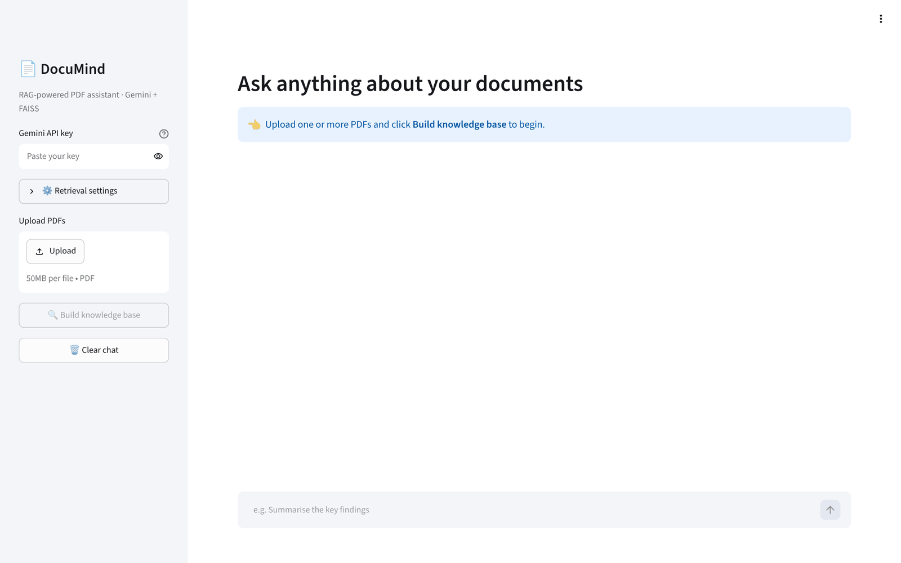

<div align="center">

# 📄 DocuMind

### Chat with your PDFs using Retrieval-Augmented Generation (RAG)


[](https://YOUR-DOCUMIND-APP.streamlit.app)



</div>

---

## ✨ Overview

**DocuMind** lets you upload one or more PDF documents — research papers, textbooks, contracts, notes — and ask questions about them in plain language. Instead of sending the whole document to an LLM, it uses a **RAG pipeline**: the documents are split into chunks, converted into vector embeddings, stored in a **FAISS** index, and only the most relevant chunks are retrieved and passed to **Google Gemini** to generate a grounded answer **with page-level citations**.

## 🚀 Features

- 📚 **Multi-PDF knowledge base** — upload several documents at once
- 🔎 **Semantic search** with FAISS (cosine similarity on normalised embeddings)
- 🧠 **Grounded answers** — the model answers only from your documents and cites `[file, page]`
- 💬 **Conversational memory** — follow-up questions understand earlier context
- ⚙️ **Tunable retrieval** — chunk size, overlap and top-k from the sidebar
- 🧾 **Source viewer** — see exactly which passages were used and their similarity scores
- ✅ **Offline unit tests** using a deterministic fake embedder (no API key needed)

## 🏗️ Architecture

```
            ┌────────────┐   extract    ┌──────────────┐   embed    ┌──────────────┐
  PDFs ───▶ │  pypdf     │ ───────────▶ │   Chunker    │ ─────────▶ │ FAISS Index  │
            └────────────┘   pages      │ (overlap)    │  Gemini    └──────┬───────┘
                                        └──────────────┘                   │ top-k
                                                                           ▼
  User question ──▶ embed ──▶ similarity search ──▶ prompt (context + history) ──▶ Gemini ──▶ Answer + citations
```

## 📁 Project Structure

```
documind/
├── app.py               # Streamlit user interface
├── src/
│   ├── loader.py        # PDF extraction + smart overlapping chunking
│   ├── vectorstore.py   # FAISS vector store (add / search / save / load)
│   ├── llm.py           # Gemini client (embeddings + generation)
│   └── rag.py           # RAG pipeline & prompt construction
├── tests/
│   └── test_pipeline.py # Offline unit tests
├── requirements.txt
└── .env.example
```

## ⚡ Quick Start

```bash
# 1. Clone
git clone https://github.com/umeshgoingtohieng/documind.git
cd documind

# 2. Create virtual environment
python -m venv venv
source venv/bin/activate        # Windows: venv\Scripts\activate

# 3. Install dependencies
pip install -r requirements.txt

# 4. Add your free Gemini API key  (https://aistudio.google.com/apikey)
cp .env.example .env            # then edit .env

# 5. Run
streamlit run app.py
```

Open `http://localhost:8501`, upload PDFs, click **Build knowledge base**, and start asking questions.

## 🧪 Running Tests

```bash
pytest -v
```

## 🧠 How It Works

| Step | What happens | Why it matters |
|------|--------------|----------------|
| **1. Extract** | `pypdf` reads text page by page | Keeps page numbers for citations |
| **2. Chunk** | Text split into ~1000-char chunks with 200-char overlap, breaking at sentence boundaries | Overlap preserves context across chunk edges |
| **3. Embed** | Each chunk becomes a vector via `gemini-embedding-001` | Captures meaning, not just keywords |
| **4. Index** | Vectors are L2-normalised and stored in `faiss.IndexFlatIP` | Inner product on unit vectors = cosine similarity |
| **5. Retrieve** | The question is embedded and the top-k closest chunks are fetched | Only relevant context reaches the LLM |
| **6. Generate** | Gemini answers using a strict system prompt that requires citations | Reduces hallucination |

## 🛣️ Roadmap

- [ ] Persist the index to disk between sessions
- [ ] Hybrid search (BM25 + vectors)
- [ ] Support for DOCX and web URLs
- [ ] Streaming responses
- [ ] Docker image + deployment on Streamlit Cloud

## 📜 License

Released under the [MIT License](LICENSE).

---

<div align="center">Made with ❤️ by <a href="https://github.com/umeshgoingtohieng">Umesh Meena</a> · ⭐ Star this repo if you found it useful!</div>
